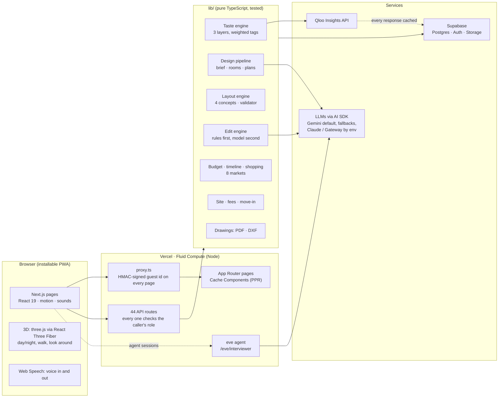
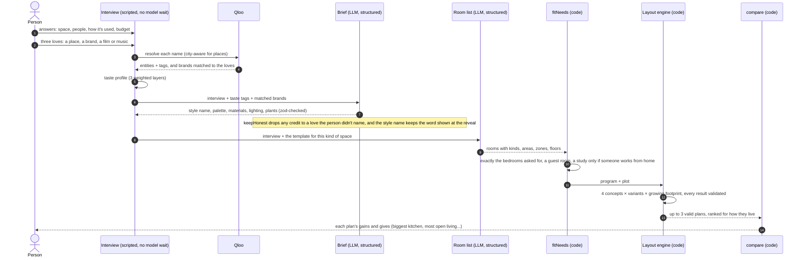
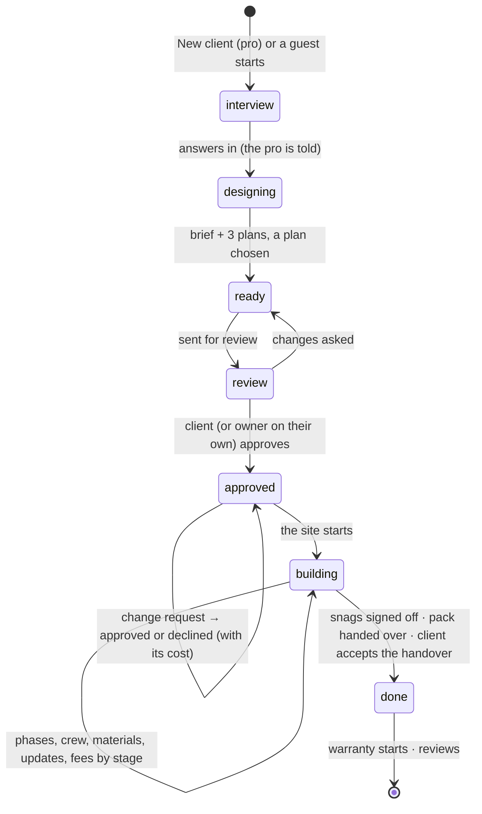
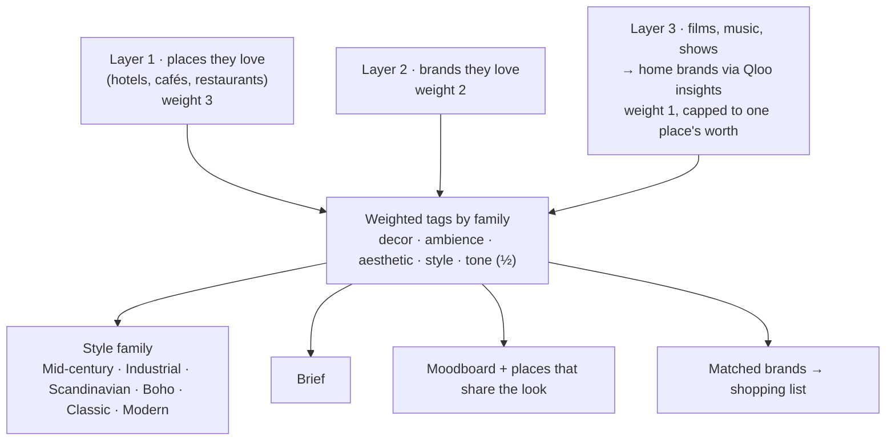
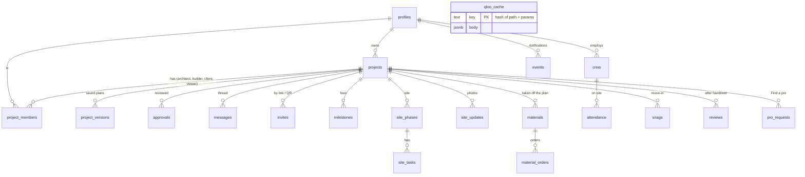

# Arcon

**An AI architect that designs a space around who you are, then stays with the project until you move in.**

Tell Arcon about the space and three things you love: a place, a brand, a film or some music. Qloo's taste AI reads what they share, and Arcon turns it into a style, three floor plans with honest trade-offs, a 3D walkthrough by day and night, a budget in your currency, a shopping list, a drawings pack, and a shared project your architect, client and builder run together: review, change requests, fees, the building site, snags, handover and warranty.

Built for the **Qloo Agentic Hackathon 2026**. Live at **[arcon-ten.vercel.app](https://arcon-ten.vercel.app)**.

- **Film:** a one-minute run of the app from every side, on the landing page ("See it in under a minute").
- **Stack:** Next.js 16 (App Router, Cache Components) · React 19 · TypeScript · AI SDK 7 · eve · Qloo Insights API · three.js (React Three Fiber) · Supabase (Postgres, Auth, Storage) · Vercel (Fluid Compute).
- **Quality:** 414 unit tests, integration checks against the real services, 19 agent evals, live checks after every deploy, and end-to-end journeys run in the browser on desktop and phone.

---

## For judges

**Open [arcon-ten.vercel.app](https://arcon-ten.vercel.app) and press "For judges".** No sign-in, nothing to install.

- **A guided tour, 12 stops in three chapters** (about three minutes): Maya's interview plays itself and Qloo reads her three picks; her style, three plans, the 3D walk, the budget, the shopping list and the drawings; then her architect's studio, her builder's site and another client's last week before moving in; then a Brooklyn café designed against its own street, by night. Switch between the homeowner, architect, builder and café owner at any stop.
- **Then "Try it yourself":** a fresh interview in any language, your own three picks read by Qloo, and a complete design of your own, with every feature open.
- The tour's world is seeded through the real app, so it is the same for every judge and never waits on a model.

**Five minutes in the code, in this order:**

1. `lib/qloo/taste.ts` and `lib/qloo/profile.ts`: three layers of taste (places, brands, culture) read from Qloo and weighted into one style.
2. `lib/design/run.ts`: the design agents, from the Qloo taste profile to the brief, the rooms and three plans.
3. `agents/interviewer/`: the interviewer agent built with eve, its Qloo tools and its 19 evals.
4. `lib/design/options.ts`: why each plan fits you, ranked from your answers and your Qloo taste.
5. `lib/neighbourhood/`: a business read against its street with Qloo heatmaps and local places.
6. `lib/layout/` and `lib/three/`: the layout engine, its validator, and the 3D built from the same plan.

## Qloo at the core

Arcon does not run without Qloo. Every design starts from the taste Qloo reads, and every decision in it shows the Qloo signal it came from.

- **17 modules** call Qloo, through **three Qloo APIs**: Insights (`/v2/insights`), Search (`/search`) and heatmaps, with location, radius, popularity, price-level and age signals.
- **Seven entity types:** places, brands, films, TV shows, artists, albums and destinations.
- **20+ tag families:** decor, ambience, aesthetic property, emotional tone, style, price level, sustainability, industry, place categories, dining and service options.

| Qloo signal | Design decision it drives | Where it shows | Code |
|---|---|---|---|
| Decor and ambience tags of places you love | Style name and words, room moods and light | Your style; "Mood, read by Qloo" in 3D | `lib/qloo/taste.ts`, `lib/qloo/words.ts`, `lib/three/mood.ts` |
| Aesthetic and emotional tags of brands you love | Materials, palette, furniture style | Style words with their sources; the 3D | `lib/qloo/profile.ts` |
| Films, TV and music through Insights | Brand discovery, art wall, playlist | Moodboard; Art and sound | `lib/design/moodboard.ts`, `lib/art/` |
| Price level, hotel class | The finish level the budget opens at | Budget | `lib/budget/tier.ts` |
| Matched brands, competitors, local stores | Shopping list at each price level | Shopping list | `lib/shop/fetch.ts` |
| Sustainability tags, plant nurseries nearby | Greenery score and plant sourcing | Budget, greenery | `lib/green/eco.ts` |
| Interests behind each layout | Ranking of the three plans, "why this fits you" | Plans | `lib/design/options.ts`, `lib/design/trail.ts` |
| Heatmaps, local places by age | Neighbourhood read for a business | A café's neighbourhood | `lib/neighbourhood/` |
| Live entity search | Taste picks resolved as you tap them | The interview | `lib/interview/logic.ts`, `app/api/interview/taste/` |

The client (`lib/qloo/client.ts`) caches every answer in the project database and spaces calls under the key's rate, so a question is asked of Qloo once.

### Agentic

- **The interviewer agent**, built with the eve agent framework, with Qloo tools to find and add taste (`agents/interviewer/agent/tools/find_taste.ts`, `add_taste.ts`), its own instructions, and 19 evals (`agents/interviewer/evals/`).
- **The design agents:** the brief, the room programme and three plans, each step grounded in the Qloo taste profile, checked by code before anything is drawn (`lib/design/run.ts`, `lib/design/brief.ts`, `lib/design/program.ts`).
- **Changes by chat:** a request in plain words becomes a tool call that edits the design, re-checked and re-priced (`lib/workspace/ask.ts`, `app/api/projects/[id]/edit/route.ts`).

### The databases behind Arcon

| Database | What it holds | What Arcon does with it |
|---|---|---|
| Qloo taste database | 250M+ entities across places, brands, film, TV, music and destinations, with their tags and audiences | Style, materials, brands, art, playlist, budget level, plan reasons, the neighbourhood read |
| Arcon cost database | Building and finishing rates for 8 markets in local currency, four finish levels, each market with its published sources (`lib/budget/rates.ts`) | Budget by room and trade, the timeline, the cost of every change |
| OpenStreetMap | Cities and streets | The interview's city check; placing a business on its street |
| Arcon project database (Supabase Postgres) | Projects, versions, the thread, sites, fees, and the cache of every Qloo answer | One record for owner, architect, builder and client |

---

## Contents

1. [For judges](#for-judges)
1. [Qloo at the core](#qloo-at-the-core)
1. [Who it's for](#who-its-for)
2. [Architecture](#architecture)
3. [The AI: what models do, and what they never do](#the-ai-what-models-do-and-what-they-never-do)
4. [Taste: the Qloo engine](#taste-the-qloo-engine)
5. [Space: the layout engine](#space-the-layout-engine)
6. [Change: the edit engine](#change-the-edit-engine)
7. [Money and time: budget, shopping, timeline](#money-and-time-budget-shopping-timeline)
8. [Collaboration: roles, review, the site, moving in](#collaboration-roles-review-the-site-moving-in)
9. [Data model](#data-model)
10. [Security and privacy](#security-and-privacy)
11. [Testing and evaluation](#testing-and-evaluation)
12. [Performance and cost](#performance-and-cost)
13. [Repository layout](#repository-layout)
14. [Run it](#run-it)

---

## Who it's for

| | What Arcon does for them |
|---|---|
| **Homeowners** | The interview (typed, tapped or spoken, in English, Hindi or Hinglish), their style read by Qloo, three plans, the 3D, changes by chat, a budget and shopping list, then the build and the move-in. Try it free without an account; sign in to keep it and unlock it. |
| **Business owners** (café, office, shop, hotel) | Everything a home gets, plus how the place runs (service, seats, kitchen) shaping the plans, a read of the neighbourhood's crowd through Qloo, and a countdown to opening day. |
| **Architects and designers** (Studio) | A client's taste read before the first meeting, three plans on day one, changes priced at once, review and change requests on record, fees by milestone, a pipeline of every client, their own branding on drawings, and owners who find them by taste match. |
| **Builders** (Build) | A site plan from the approved design (phases with dates, materials taken off the plan), crew and wages, materials and deliveries, site money, photo updates the client follows, payments by stage of the build, snags, handover and reviews. |
| **Clients** | Invited by their architect or builder, free: answer the interview at home, see their style revealed, approve the design and every later change in the thread. |

---

## Architecture



**How a design is made.** Everything a model writes passes through code that checks it. The model proposes; the engines decide what is valid, what is honest and what fits.



**A project's life.** Status moves only forward, and each step has a person who can take it.



---

## The AI: what models do, and what they never do

Arcon uses models where judgement and language matter, and plain code wherever a rule can be checked.

| Model does | Code does |
|---|---|
| The style brief: name, palette, materials, lighting, plants, written from the taste tags | Checks it against a zod schema; drops any "from" credit to something the person didn't love (`keepHonest`); keeps the style word shown at the reveal (`keepStyle`) |
| The room list for this person (rooms, areas, zones, floors) | Gives every room a unique id, puts it on a floor that exists, fixes the bedroom count, guest room and study to the answers (`fitNeeds`); falls back to the tested template if the list can't be laid out |
| Reading an uploaded floor plan photo or PDF (vision) | Snaps it into an editable layout, then asks the person to confirm what it was unsure of |
| Understanding a change it hasn't seen ("give the kids more space") | Parses common changes without a model at all, maps the model's answer to the same typed `Change`, applies it through the engine |

**Model routing.** One place (`lib/models.ts`) picks the model for every agent; switching is one env var (`ARCON_MODEL`). Each provider is called directly when its own key is set, otherwise through Vercel AI Gateway. When the chosen Gemini model is out of quota, the call falls through a list of other models (`withFallback`), so a busy day never stops the interview.

**The interview.** The interview the app runs is a script: one question at a time, every answer typed, tapped or spoken, each the next question at once, with nothing waiting on a model. Answers survive a reload. Taste answers are matched in Qloo as they're typed, with the project's city first for places. An interviewer agent built with **eve** lives in `agents/interviewer/` (instructions, 8 tools such as `find_taste`, `save_living`, `finish_interview`, and 17 evals, including Hindi, Hinglish and prompt injection) and is mounted at `/eve/interviewer`.

**Grounding.** Every material, colour and brand in a design names the love it came from. A design never claims a source the person didn't give.

---

## Taste: the Qloo engine



- **Three layers, strongest first.** Places carry decor and ambience directly; brands carry aesthetic and emotional tone; culture reaches home brands through Qloo insights. All layer-3 brands together weigh about one named place, so many matches can't drown what the person said.
- **Known names.** Matched home brands prefer ones people know (popularity ≥ 0.8, falling back to the long tail only when too few match), and must actually make things for a home: magazines, apps, clothing-only labels and services are filtered out from Qloo's own industry and brand-type tags.
- **Places that share your look** are rooms to learn from: no campsites, parks, resorts or budget chains, and a chain hotel's decor is never read as someone's look.
- **Business neighbourhood read.** For a café, shop, office or hotel: the local favourites around the site, their crowd and decor, one per chain.
- **Cache and limits.** Every Qloo response is cached in Supabase by a hash of its path and parameters, so local development and the live app share one cache and a repeated question never spends quota. Calls are spaced just under the key's 5 per second. Qloo data lives in the database, never in this repository.

---

## Space: the layout engine

`lib/layout/` is a deterministic floor-plan engine, written for this project.

- **Four concepts an architect would actually offer:** central hall with living to the street, central hall with living to the garden, an open great room with a private wing, and a split plan with a wing at each end. Each is tried with several band widths and orders.
- **A building sized to its rooms.** The footprint starts from the rooms' area plus circulation and stairs; if fewer than three concepts fit, it grows into the plot step by step (never past it), and the rest becomes garden.
- **A validator every plan must pass** (`validate.ts`): inside the shell, no overlaps, no holes, minimum widths and areas, doors on real shared walls, no two openings on one stretch of wall, the front door never into a kitchen, bath or bedroom, no private room opening off the kitchen, stairs only from circulation, floors that line up.
- **Ranked for how they live.** The interview (cooking while the kids do homework, guests often, a quiet main bedroom) and the person's taste rank the concepts, and each plan carries the reasons.
- **Honest comparisons** (`compare.ts`): each option names what it does best and what it gives up (biggest kitchen, most open living, least floor lost to halls), only where the difference is noticeable.

---

## Change: the edit engine

```mermaid
flowchart LR
  Txt["“make the kitchen bigger”"] --> U["understand.ts<br/>rules: resize · add · remove · rename · kitchen open/closed<br/>(English, Hindi, Hinglish)"]
  U -- not understood --> M["ask.ts<br/>one model call → the same typed Change"]
  U --> A
  M --> A["applyChange"]
  A --> S1["inside the building:<br/>strengths × which rooms give way<br/>(all · same zone · same floor)"]
  S1 -- nothing fits --> S2["grow into the garden<br/>+8% · +16% · +25%, never past the plot"]
  S1 & S2 --> V["every candidate validated,<br/>least upheaval wins"]
  V --> Ver["saved as a new version · budget, 3D and drawings follow"]
  Ver --> CR{"design approved?"}
  CR -- yes --> Req["change request to whoever approves,<br/>with its cost difference"]
```



- A resize tries several strengths of the change, with every other room easing back, only its zone easing back, or its whole floor giving way, and keeps the result that moves the room the asked way with the least disturbance to everything else (`upheaval`). 99 of 102 resizes across the templates now succeed; the rest say plainly why.
- A rename can't create two rooms with the same name. Undo walks back through saved versions.
- After approval, a change is a **change request**: it shows what changed and what it does to the cost, and is built only once approved. Declined, the design returns to the approved version. An owner on their own approves as they go.

---

## Money and time: budget, shopping, timeline

- **Eight markets** (US, Canada, UK, Germany, Australia, UAE, Singapore, India), each with researched rates per tier (essential, mid-range, premium, luxury) and a source note beside each number, plus regional factors (the US West costs more than the Midwest).
- **One estimate everywhere.** The quality the person told us is where every screen starts (home card, budget, shopping, Make changes, drawings); their taste's price level is shown next to it. A new build adds construction on the whole floor area.
- **Priced by room and trade:** finishes and wiring per m², a kitchen scaled gently by its size around a typical 14 m², bathrooms (a powder room at 45%), furniture per m² by room kind, plants, fees.
- **Shopping list:** each piece from a brand in their taste at the chosen tier, a dearer and a cheaper alternative, and furniture stores near the site ranked for their taste.
- **Timeline** from the size of the job and the lead time of made-to-measure work, which also seeds the building site's phases and a business's opening day.
- **Green score** per room, with one change per room to raise it, shown in the 3D.

---

## Collaboration: roles, review, the site, moving in

- **Roles per project:** owner, architect, builder, client, viewer, checked by one `can(role, action)` table and by every API route. One client per project, on a pro's project only. A pro whose plan has lapsed keeps their projects read-only; the site stays open.
- **Team:** invite by link or QR (the panel opens on the role you asked for), or an owner finds a pro in **Find a pro**, ranked by how close the pro's past work is to the owner's taste. A pro sees the design before accepting, then answers right on the project.
- **The thread:** one conversation per project, room by room, with photos and files, every approval and change request on record, and a team-only channel once two pros are on it. The bell marks a notification read only when it's opened; phases finish quietly.
- **Fees:** a pro sets out a fee once; an architect's splits by design stage, a builder's by stage of the build; every name and amount editable. Billed, paid, received; overdue after 14 days; the payer always sees who each fee is to.
- **The site:** phases with dates, tasks, crew and attendance, wages, materials taken off the plan, orders and deliveries, photo updates and late alerts. The client sees progress and the budget, never the builder's own costs. An owner can run the build themselves.
- **Moving in:** the client lists snags room by room; whoever runs the site fixes them; the client signs each off. The handover pack (warranty, notes, drawings), a warning if fees are unsettled, the client accepts the handover and the warranty starts that day. Reviews go on the pro's profile and the pro is told.
- **Business views:** fee ledger, crew and wages across sites, materials and deliveries, site money (budget against spend).

---

## Data model



23 tables across 15 ordered migrations in `db/migrations/`. A project keeps its design as JSON: the interview, taste signals and profile, the brief, the room program, three plan options and the chosen one; every change is a row in `project_versions`.

---

## Security and privacy

- **Sessions:** guests get an HMAC-SHA-256 signed id in an httpOnly cookie from `proxy.ts` on their first page; signed-in people a signed user cookie after Supabase Auth. Signatures are compared in constant time. When a guest signs in, their projects move to the account.
- **Every route checks access:** who is asking and their role on the project, before any read or write. Clients never see a builder's costs; strangers get 404, not 403.
- **Agents** only answer requests carrying a valid signed cookie. The interview treats answers as data: an eval checks that instructions hidden in an answer are ignored.
- **Keys** live only in environment variables (local `.env` files, Vercel). Qloo responses live in the database, and the film (which shows Qloo images) in storage, never in the repository.
- **Privacy:** one essential cookie, no tracking, no ads. Delete a project or the whole account at any time (typing DELETE); files go with them.
- **Sign-up** refuses addresses whose domain can't receive mail.

---

## Testing and evaluation

| Layer | What runs | Where |
|---|---|---|
| Unit | 394 tests: layout engine and validator, every edit, taste weighting, budget and markets, fees, roles, move-in, notifications, interview logic | `lib/**/*.test.ts` with `node --test` |
| Integration | The design pipeline and the project store against the real services | `lib/**/*.integration.ts` |
| Agent evals | 17 eve evals: one question at a time, all-at-once answers, Hindi, Hinglish, metric, off-topic, no match, ambiguous, prompt injection, cafés, offices, hotels | `agents/interviewer/evals/` |
| Live checks | After every deploy, as the test accounts, from the server: pages, roles and permissions, the site, the Qloo strip, the quiz, the sidebar, the business views, moving in | `scripts/live-check.ts` |
| End to end | Eight journeys by hand in Chrome (a guest's house to move-in, Find a pro, an architect with a client by link and in person, design-and-build, a café, a self-build, phone width), re-run after every round of fixes | run notes |

`npm test`, `npx tsc --noEmit` and `npx eslint` pass before every commit; `next build` before every push.

---

## Performance and cost

- **Cache Components:** pages prerender their static shell and stream the rest.
- **The interview never waits on a model**; the design runs once, after the last answer, and a retry only does what's missing.
- **Qloo** answers come from the shared cache after the first time; calls are spaced to the key's limit.
- **The 3D** is low-poly and drawn on demand; on a phone or slower computer the plan drawing shows first and the 3D loads on a tap.
- **Model fallbacks** keep the app working on a free-tier quota.

---

## Repository layout

```
app/              pages and 44 API routes (Next.js App Router); proxy.ts signs guests
components/       screens: landing, interview, project (plans, 3D, budget, site, move-in), shell, manage
  fx/             shared sounds, motion and the decode effect
  three/          the 3D scene
lib/              the logic, each part with its tests beside it
  qloo/           client (cache, rate limit), taste engine, filters
  design/         brief, room program, plan options, comparisons, moodboard
  layout/         concepts, placement, footprint, validator, walls
  workspace/      understand (rules), ask (model), edit (applyChange)
  budget/ shop/   rates for 8 markets, estimate, timeline, shopping list
  project/ site/  roles, review, change requests, team, thread, fees, site, move-in
  export/         drawings pack (PDF) and DXF
agents/interviewer/  the eve agent: instructions, tools, evals
db/migrations/    15 migrations, applied in order
scripts/          migrations, live checks, the film recorder, test helpers
```

---

## Run it

```bash
npm install
cp .env.example .env.local     # Supabase, Qloo and model keys (and .env)
npm run migrate                # creates the tables in Supabase
npm run dev                    # http://localhost:3000
npm test                       # unit tests
npx tsc --noEmit && npx eslint # types and lint
```

**Environment** (see `.env.example`): `QLOO_API_KEY`, `ARCON_SESSION_SECRET` (32+ random characters; signs the cookies), `SUPABASE_URL`, `SUPABASE_SERVICE_ROLE_KEY`, `NEXT_PUBLIC_SUPABASE_URL`, `NEXT_PUBLIC_SUPABASE_PUBLISHABLE_KEY`, `POSTGRES_URL_NON_POOLING` (for migrations), and a model key (`GOOGLE_GENERATIVE_AI_API_KEY`, or `ANTHROPIC_API_KEY`, or an AI Gateway key). `ARCON_MODEL` picks the model.

**Useful scripts**

| Script | What it does |
|---|---|
| `scripts/live-check.ts` | Checks the deployed site end to end as the test accounts |
| `scripts/record-video.ts` | Records the film from every role and fits it under a minute with ffmpeg |
| `scripts/upload-video.ts` | Puts the film in storage for the landing page |
| `scripts/role-sessions.ts` | Signed sessions for local testing as each role |
| `scripts/seed-demo.ts` | A demo project run through the real design pipeline |

---

## Licence

MIT. See [LICENSE](LICENSE).
